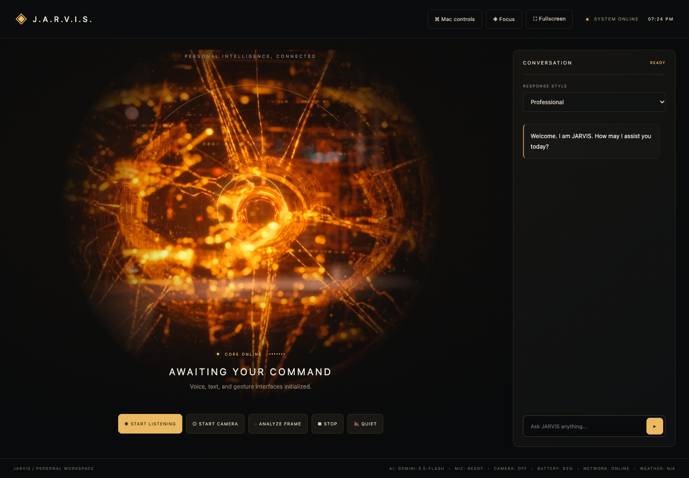

<div align="center">

# J.A.R.V.I.S.

### A voice and vision assistant for macOS

Ask a question. Show an object. Launch an approved app.

A local web workspace that connects conversational AI, camera context, browser speech, and a constrained macOS bridge.

[](https://github.com/Dhee-Raz/Jarvis/actions/workflows/tests.yml)


[Quick start](#quick-start) · [Architecture](docs/ARCHITECTURE.md) · [Demo walkthrough](docs/DEMO.md) · [Tests](#tests)

</div>



## Why I built it

Most chat interfaces only know what you type. Jarvis explores a more contextual personal assistant: one interface for speaking, asking about what is in view, remembering preferences, and requesting specific Mac actions.

This is a working personal prototype. It demonstrates application integration and interaction design; it does not train a custom AI model or process continuous video.

## What it does

| Capability | Experience |
| --- | --- |
| Conversational AI | Text questions, response styles, and recent conversation context. Gemini is tried first when configured; Ollama handles fallback. |
| Voice interaction | Click to speak, use a wake word for later commands, and hear replies through browser speech synthesis. The gold core lights up while speaking. |
| Camera context | See a preview below chat. Each question can attach a fresh snapshot, supporting prompts such as “What am I holding?” and “What color is it?” |
| Background vision | Periodic scene and activity observations, pause/resume, optional spoken updates, and retries on provider errors. |
| Gesture controls | Optional MediaPipe hand tracking: open palm halts speech, pinch toggles speech, and thumbs-up acknowledges the gesture. |
| Mac integrations | A toolbar for approved apps, HTTPS websites, and Music controls; chat shortcuts for Notes, Reminders, and Calendar. UI actions ask for confirmation. |
| Local memory | Save facts, preferences, and tasks in a local JSON file; delete individual entries or clear them. |
| Workspace | Fullscreen and focus modes, system indicators, and optional weather configuration. |

## Engineering highlights

- **Provider adapters:** Flask normalizes chat requests and translates conversation history into Gemini or Ollama formats. Image requests respect the configured vision mode.
- **Request lifecycle management:** Camera analysis uses cancellation, session checks, and retry backoff. Late results are discarded after pausing or stopping the camera.
- **Foreground priority:** Background vision defers during chat requests and while the tab is hidden. Questions capture a fresh frame instead of relying on an earlier timer snapshot.
- **Browser and OS integration:** Browser APIs handle speech and camera permissions; fixed macOS integrations use argument-based subprocess calls rather than arbitrary shell execution.
- **Explicit boundaries:** Loopback-only serving, Host and POST Origin checks, request limits, app allowlists, and camera-sharing controls. These are prototype safeguards, not a multi-user authorization system.
- **Regression coverage:** 15 Python API tests and 11 JavaScript interface and camera lifecycle tests run without live provider credentials or a webcam.

Read the [architecture and tradeoffs](docs/ARCHITECTURE.md) for the implementation details.

## Quick start

### Requirements

- macOS for native app integrations.
- Python 3.12 or newer. CI exercises Python 3.12 and 3.14.
- A browser with camera support. Chrome is a practical starting point for browser speech recognition; availability varies by browser.
- At least one configured AI provider: Gemini credentials or a running Ollama server with a downloaded model.
- Node.js 22 or newer to run the JavaScript tests; it is not needed to serve the app.

### 1. Clone and install

```bash
git clone https://github.com/Dhee-Raz/Jarvis.git
cd Jarvis
python3 -m venv .venv
source .venv/bin/activate
python -m pip install -r requirements.txt
# Preserve an existing local configuration.
test -f .env || cp .env.example .env
```

### 2. Configure an AI provider

**Gemini:** Put your own `GEMINI_API_KEY` in `.env` and set `GEMINI_MODEL` to a model available to your account. Obtain credentials through [Google AI Studio](https://aistudio.google.com/api-keys). Provider availability, quotas, and billing depend on your account.

**Ollama:** Install and start [Ollama](https://ollama.com/download), then download a model:

```bash
# Text chat
ollama pull llama3.2
# Optional: vision-capable local model for camera questions
ollama pull llava
```

For local camera analysis, set these values in `.env`:

```dotenv
OLLAMA_MODEL=llava
VISION_MODE=local-only
```

`local-only` applies to image requests. Text requests still try Gemini first when a Gemini key is configured. Leave `GEMINI_API_KEY` empty if you want text inference through Ollama too. Model performance and memory usage depend on your machine.

### 3. Run

```bash
python app.py
```

Open **http://127.0.0.1:8765**. Start with a typed message. Enable microphone or camera access only when trying those features.

For local Waitress serving:

```bash
JARVIS_PRODUCTION=true python app.py
```

The app remains a single-user, loopback-only service; this flag does not make it ready for public hosting.

## Try it in two minutes

1. Ask: **“Explain this project in two sentences.”**
2. Click **Start listening** and speak a command. For subsequent commands, say **“Hey Jarvis”** or click the button again.
3. Click **Start camera** and allow access. Keep **Use live camera in my questions** checked. Hold up an object and ask **“What am I holding?”**, then **“What color is it?”**
4. Open **Mac controls**, select Calculator, and approve the launch.
5. Type **“Remember that I prefer concise answers.”** Inspect or delete the saved entry in Mac controls.

See the [demo guide](docs/DEMO.md) for a longer walkthrough and troubleshooting. Timers currently accept digits, such as **“Set a timer for 10 seconds.”**

## Tests

No Gemini key, Ollama server, camera, or macOS automation permission is needed for the automated suite. External integrations are mocked.

```bash
python -m unittest -v
node --check static/app.js
node --test test_interface.cjs test_live_vision.cjs
```

| Suite | Coverage |
| --- | --- |
| `test_app.py` | API validation, memory operations, allowlisted actions, confirmation requirements for productivity writes, Gemini history roles, and local vision routing. |
| `test_interface.cjs` | Template/control wiring, Mac panel interaction, permission errors, camera placement, fresh question snapshots, opt-out, and unready-camera handling. |
| `test_live_vision.cjs` | Frame sizing, scheduling, cancellation, stale responses, camera cleanup, hidden-tab deferral, and retry behavior. |

GitHub Actions runs these checks on pushes and pull requests. Physical webcam behavior, browser speech, live model quality, and native app permissions require a manual check; the suite does not replace those checks.

## Configuration

Copy the keys from [`.env.example`](.env.example); keep real credentials in your ignored `.env` file.

| Variable | Purpose |
| --- | --- |
| `GEMINI_API_KEY` | Optional cloud-provider credential. |
| `GEMINI_MODEL` | Gemini model identifier available to your account. |
| `OLLAMA_MODEL` | Downloaded Ollama model; camera questions require vision support. |
| `VISION_MODE` | `cloud-preferred` or `local-only` for image requests. |
| `JARVIS_PORT` | Local HTTP port, default `8765`. |
| `JARVIS_PRODUCTION` | `true` selects Waitress instead of the Flask development server. |
| `WEATHER_LATITUDE`, `WEATHER_LONGITUDE` | Optional weather coordinates. |

## Privacy and practical limits

- Opening the camera enables periodic snapshot analysis. With cloud-preferred vision, frames may be sent to Gemini. **Pause analysis** stops background sharing; frames still accompany questions when **Use live camera in my questions** is checked. **Stop** ends capture and cancels the pending browser request.
- Snapshots describe visible moments, not continuous movement. Observations can be delayed or wrong, and prior summaries may be outdated. Jarvis is not intended for surveillance, identity recognition, or safety-critical monitoring.
- Browser speech recognition may use the browser vendor's servers, even when AI inference uses Ollama. Camera frames are not written to disk by the app.
- Saved memory is an unencrypted local `jarvis_memory.json` file. Selected memory is sent as context with chat requests. `.env` and the memory file are excluded from Git.
- UI confirmation is part of the interaction design. The backend also requires a confirmation field for note, reminder, and calendar writes; it does not provide authentication or universal server-side approval enforcement.
- Do not expose the local bridge to a public network. Native automation permissions are controlled by macOS. Voice-command parsing covers a limited set of explicit patterns.

## Project map

```text
app.py                   Flask routes, provider adapters, macOS bridge
static/app.js            Chat, speech, camera analysis, and UI state
static/style.css         Responsive gold-core workspace and animations
templates/index.html     Main interface
.env.example             Configuration template without credentials
test_app.py              Python API regression tests
test_interface.cjs       JavaScript interface and question-context tests
test_live_vision.cjs      JavaScript camera lifecycle tests
docs/                    Architecture, demo guide, and actual UI screenshot
.github/workflows/       Automated checks
```

## Next steps

Planned work, not completed features:

- Browser-level integration tests for camera permissions and speech lifecycle.
- Separate text and vision model configuration, plus clearer provider health checks.
- Streaming responses and measured latency under repeatable workloads.
- Stronger server-side approval enforcement for every native action.
- Refactor the single frontend module and backend file as the feature set grows.

The gold-core visual was supplied as a project reference. No ownership or redistribution rights for third-party artwork are claimed. This repository currently has no open-source license; public visibility alone does not grant reuse rights.
