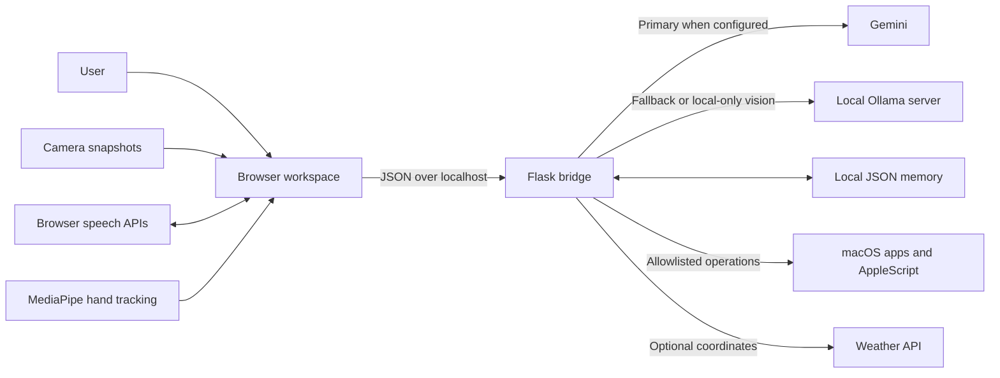
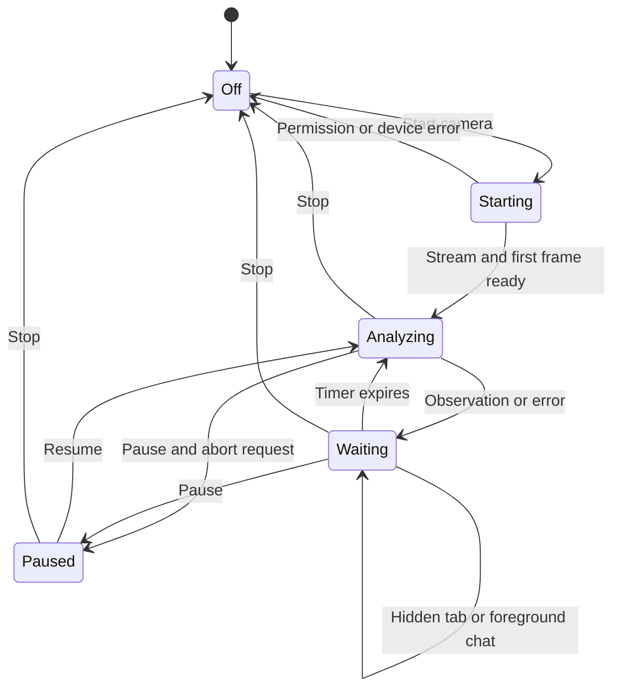

# Architecture and engineering decisions

Jarvis is a single-user application: a browser interface talks to a Flask service running on the same machine. The service mediates AI calls and a small set of native macOS operations.

## System overview

### Ownership of state

| State | Location | Lifetime |
| --- | --- | --- |
| Conversation history | Browser JavaScript | Current page session; recent 12 messages sent to the API. |
| Captured frame | Browser canvas / data URL | Replaced during capture and cleared when the camera stops. |
| Scene summary | Browser JavaScript | Current camera session; latest successful background observation. |
| Saved facts and preferences | Local JSON file | Persists until deleted through the app or filesystem. |
| Provider credentials | Local environment / `.env` | Server-side; never embedded in the HTML or JavaScript. |
| Request throttling | Python process memory | Resets when the server restarts. |

## Chat request path

1. The client handles supported local shortcuts such as timers and memory commands.
2. For AI questions it builds a request with text, recent history, selected memory, and response style.
3. When camera answers are enabled, it captures a fresh bounded JPEG frame. An earlier scene summary may accompany the question as explicitly outdated context.
4. Flask validates image format and size, history roles and lengths, and memory limits.
5. Image requests in `local-only` mode go directly to Ollama. Otherwise, Gemini is attempted when configured, followed by Ollama on failure.
6. The adapters translate provider-specific history formats. Gemini assistant turns use the `model` role.
7. The response updates the conversation. Browser speech synthesis emits the events that drive core illumination.

Provider failure produces an error response when fallback also fails. There is no streaming response path, and fallback can increase latency. The API's dashboard indicates configuration rather than proving that a provider is healthy.

## Camera request lifecycle

Camera opening requests a video-only browser stream. Preview and scene analysis start independently of optional MediaPipe hand tracking. Frames are scaled to at most 640 pixels wide and encoded as JPEGs.

A successful background response schedules the next analysis eight seconds later. Failures increase the delay up to 30 seconds; a browser-side timeout aborts a request after 45 seconds. The server's provider request may continue until its own timeout after a browser disconnect.

Session counters and request-controller identity checks reject late responses from a stopped or replaced camera session. Stopping closes media tracks, aborts pending browser analysis, clears timers and frames, and hides the preview.

A foreground camera question cancels the background analysis request and sends a newly captured frame. It restarts background scheduling when the question finishes. Turning off camera answers prevents automatic frame attachment to chat; explicit Analyze Frame remains available.

This design deliberately samples scenes instead of uploading every frame. It reduces request volume and keeps interaction manageable, but it cannot establish continuous motion or a complete activity timeline.

## Native action boundary

The model does not execute tool calls. The frontend has explicit controls and limited command patterns that invoke fixed server routes.

- Application launching uses an approved application map and argument-based `open` calls.
- Website opening accepts bounded HTTPS URLs with hostname, credential, and port checks.
- Notes, Reminders, Calendar, and Music use fixed AppleScript templates. User values are passed as arguments for productivity writes.
- The UI asks for confirmation before native actions. Productivity writes also require a backend `confirmed` field.

These controls limit exposed operations; they are not an authenticated permission system. Some action routes rely on the UI confirmation rather than universal backend approval. The service must remain local.

## Test strategy

Python tests exercise Flask through its test client and mock provider and native calls. JavaScript tests run the interface logic in Node VM contexts with browser and network doubles. They check request payloads, state transitions, cancellation, fresh captures, and template IDs.

This keeps tests deterministic and credential-free. It does not establish that a particular browser can access a physical camera, that a provider's visual answer is correct, or that macOS has granted automation permission. The [demo guide](DEMO.md) covers those manual checks.

## Tradeoffs and growth areas

| Choice | Benefit | Cost / future direction |
| --- | --- | --- |
| Vanilla JavaScript and Flask | Small application with directly inspectable request flow. | State and routes are concentrated in two files; extract modules as complexity grows. |
| JSON memory | Easy to inspect and delete without a database service. | No encryption, transaction handling, or multi-user isolation. |
| Sequential provider fallback | A configured alternative can answer when the primary fails. | Extra wait on primary failure; health checks and latency measurements remain future work. |
| Browser speech APIs | No separate audio upload or speech server implemented by this app. | Browser support and vendor-side processing vary. |
| Loopback Mac bridge | Small local integration surface. | No remote deployment, account system, or multi-user access model. |
